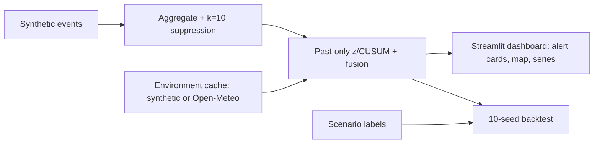

# MedS Hub Medicine Signals

An explainable early-warning prototype that flags **possible medicine shortages** and **unusual demand** from aggregate pharmacy signals in Egypt. It was built for the Future Health Digital Innovation Challenge, statement 06 (Population and Workforce Health Early Warning).

> **Synthetic data only.** No real users, prescriptions, pharmacies or transactions are used. Alerts are signals for investigation, not diagnoses. The tool gives no clinical or substitution advice.

## The problem
At the pharmacy counter, a shortage or a demand spike is visible early. Patients ask for the same brand at pharmacy after pharmacy, and in summer the questions shift to fever and diarrhoea medicines. Pharmacists often see this weeks before an official report appears. But the signal is scattered across thousands of counters and never reaches the people who plan supply or watch public health.

MedS Hub is a bilingual Arabic/English medicine catalog and pharmacy coordination app, with about 85,000 medicine records (October 2026). Searches, quote requests and "not available" replies in an app like this are the kind of signal that could be counted. This prototype shows how they could be counted safely and turned into explainable alerts. It is a separate, standalone repo and is not connected to MedS Hub production.

## What it does
1. **Generates** 90 days of synthetic events: 50 INNs, 6 therapeutic classes, 6 governorates and 4 event types, with labelled scenarios.
2. **Aggregates** the events into daily counts and **suppresses every cell below k=10**.
3. **Detects** anomalies. Each series has a past-only baseline (same-weekday median and MAD over a trailing 28-day window), plus a residual z-score and CUSUM.
4. **Fuses** signals, so an alert needs **two different signal types to agree**:
   - demand + persistent supply friction → `possible_shortage`
   - demand + an environmental anomaly in a pre-declared climate-sensitive class → `unusual_demand`

   Demand alone and environment alone never alert. The only single-signal route is extreme supply friction.
5. **Explains** each alert on a card. The card shows the signals and their values, the area and dates, the assumptions, a responsible role and a suggested operational follow-up.
6. **Backtests** the detector against the labelled scenarios across 10 seeds.



## Results (synthetic backtest, reproducible with `make backtest`)
| Seed set | Series sensitivity, mean (min) | Alert-level PPV proxy, mean (min) | False alarms (per 30 days) | Media-spike alerts | Missing-data alerts |
|---|---|---|---|---|---|
| Tuning (20261018, 1, 42, 7777, 99999) | 99.4% (96.9%) | 100.0% (100.0%) | 0 (0.00) | 0 | 0 |
| Hold-out (2, 3, 5, 8, 13) | 100.0% (100.0%) | 98.9% (97.2%) | 2 (0.13) | 0 | 0 |
| All 10 seeds | 99.7% (96.9%) | 99.5% (97.2%) | 2 (0.07) | 0 | 0 |

Scenario sensitivity is 100% on every seed. Each shortage series was detected on every seed (2/2), and the heatwave series reached 299/300 over the 10 seeds.

**Read these numbers with care:**
- They come from synthetic data with known labels. They are not real-world performance.
- The lead time is **0 days**. That is the delay from scenario onset to detection (alerts fire on day 1), not a prediction ahead of onset.
- The hold-out seeds informed the last detector fix, so they are not fully untouched. A fresh seed set is needed for a clean final check.

Full results are in `reports/backtest.md` and `reports/metrics.json`; the methods are in `docs/TECHNICAL.md`.

## Privacy by design
- The pipeline accepts only aggregate counts per date × INN × governorate × event type. It rejects columns with personal identifiers.
- Cells below k=10 are suppressed and treated as missing, not zero. Coarser roll-ups are used only inside the detector, as a denominator, and are never displayed.
- The prototype has no production data path and no telemetry (`gatherUsageStats = false`). The only network code is the optional Open-Meteo fetcher.
- The pharmacy referral panel lists only **MOCK** pharmacies.
- A pilot that processes real data would need a licence from Egypt's **Personal Data Protection Center** (Law 151/2020). **That licence has not been obtained yet; licensing is planned.** No compliance claim is made.

## Run it (Python 3.11+)
```bash
python -m venv .venv && . .venv/bin/activate && pip install -r requirements.txt
make demo                          # synthetic pipeline, about 10 s
streamlit run app/streamlit_app.py # dashboard; generates demo data on first run if missing
```
Other commands: `make test` (9 tests), `make backtest` (10 seeds, about 70 s) and `make all` (demo + tests). Without `make`, use `./run.sh demo|test|backtest|all`.

## Limitations
The data is synthetic and the thresholds are uncalibrated on real data. There is no role-based access control in this local prototype. App users are not a representative sample. Supply friction can only be observed where the local unavailable count is at least 10. The prototype covers Egypt only and has no clinical, laboratory or regulator shortage data. See `docs/TECHNICAL.md` for the full list and the pilot plan.

## Repository layout
| Path | Contents |
|---|---|
| `synth/` | Seeded event generator and scenarios |
| `env/` | Synthetic environment cache and optional Open-Meteo fetcher |
| `pipeline/` | Aggregation with k-suppression; detection and fusion |
| `eval/` | Multi-seed backtest |
| `app/` | Streamlit dashboard |
| `tests/` | Unit and regression tests |
| `docs/` | Technical document |

## Licence
MIT. See `LICENSE`.
