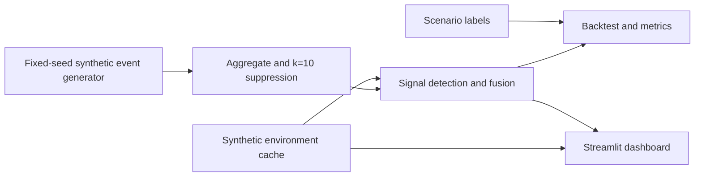

# Technical documentation — MedS Hub Medicine Signals

## Problem & fit
Prototype an explainable early-warning view for aggregate medicine-interest and supply-friction signals in Egypt. Potential fit: pharmacy-network operations and public-health surveillance. This is a prototype, not a validated service.

## Architecture

## Data & synthetic method
90 daily dates, 50 INNs in six therapeutic classes, six governorates, four event types. Fixed seed `20261018`; deterministic weekday seasonality, mild trend, Poisson/binomial noise, labelled shortage, heatwave-related ORS demand, media-driven search spike, and missing-data dates. Synthetic environment includes daily maximum temperature and PM2.5; the synthetic heatwave aligns with the ORS demand scenario. No real pharmacy, person, prescription, or user records are used.

`env/fetch_open_meteo.py` optionally fetches public historical weather and air-quality data without an API key. The default dashboard uses `env/environment.csv`, generated synthetically. Fetched environmental values should be clearly disclosed in any subsequent run.

## Methods
- **Aggregate & privacy suppression:** Aggregate counts by date, INN, class, governorate, and event type. Suppress event cells below k=10; suppressed values are treated as missing/unobserved, not zero. Prohibited personal identifier columns are rejected at ingestion. Explicitly missing rows (`data_status == "missing"`) remain NaN and do not become 0.0 or lower trailing baselines.
- **Calendar-day alignment:** Time series are aligned to a complete daily calendar (`pd.date_range`) prior to rolling calculations so that gaps do not distort trailing windows.
- **Strictly causal past-only baseline:** Weekday median from a trailing 28-day past window (`iloc[:i]`) with a 14-day warm-up period. MAD is computed strictly on past residuals with a minimum scale floor of 2.0. No future data or full-series standard deviation fallback is used.
- **Independent demand evaluation:** Demand anomalies are evaluated from `catalog_search` residual z-scores and positive CUSUM accumulation without requiring unavailability to survive suppression.
- **Coarser supply friction clearing k=10:** Supply friction is computed as `quote_unavailable / quote_request`. When local cell quote requests are suppressed below k=10, the denominator falls back to coarser aggregates that clear k=10 (INN national aggregate or class x governorate aggregate), while the numerator stays the local cell count (which must itself clear k=10). These roll-ups are internal to the detector and are never written out or displayed.
- **Climate-sensitive environmental fusion:** Environmental anomalies serve as supporting signals strictly for pre-declared climate-sensitive classes:
  - Temperature anomaly (>= +6.0°C delta against trailing 21-day local baseline) supports `antidiarrhoeals_ors`.
  - Particulate matter anomaly (>= +25.0 µg/m³ PM2.5 delta) supports `respiratory`.
  - Environmental anomalies alone never trigger an alert.
- **Extreme single-signal rule & demand corroboration:** Demand anomalies alone never trigger alerts, regardless of magnitude (the single-signal extreme demand rule has been removed). Unusual demand must be corroborated by persistent supply friction or environmental anomalies (for climate-sensitive classes). Supply friction requires persistence (present on the evaluated day AND on at least one of the previous 2 evaluated days). Extreme supply friction (unavailability ratio >= 0.55 and unsuppressed unavailable >= 10) remains a single-signal alert route. Media spikes (3x volume, z up to 19) produce demand signals but never alert because demand alone cannot trigger alerts.
- **Alert typing and episode consolidation:** An alert is typed causally on its start date as `possible_shortage` whenever persistent supply friction is present; otherwise `unusual_demand`. Consecutive daily alerts for the same INN, class, and governorate are merged into cohesive multi-day episodes (allowing up to a 2-day gap). If supply friction emerges on subsequent days within the consolidation window, the consolidated episode is upgraded to `possible_shortage`, with the causal `initial_type` and `type_history` recorded and documented in the alert assumptions.

## Validation results
Evaluated by `eval/backtest.py` across 10 randomized synthetic seeds (5 tuning seeds: `20261018`, `1`, `42`, `7777`, `99999`; and 5 hold-out seeds: `2`, `3`, `5`, `8`, `13`) against labelled synthetic ground truth; see `reports/backtest.md` and `reports/metrics.json`.

| Metric | Default Seed (20261018) | Tuning Seeds Mean (5 seeds) | Hold-out Seeds Mean (5 seeds) | Combined 10-Seed Mean (min) |
|---|---:|---:|---:|---:|
| Total alerts emitted | 32 | 32.2 | 35.2 | 33.7 (31 – 38) |
| Scenario sensitivity (shortage + heatwave) | 100.0% | 100.0% | 100.0% | 100.0% (100.0% min) |
| Series sensitivity (shortage + heatwave) | 100.0% | 99.4% | 100.0% | 99.7% (96.9% min) |
| - Shortage series recall | 2/2 (100%) | 100.0% | 100.0% | 100.0% (2/2 on all seeds) |
| - Heatwave series recall | 30/30 (100%) | 99.3% | 100.0% | 99.7% (29/30 – 30/30) |
| Alert-level PPV proxy | 100.0% | 100.0% | 98.9% | 99.5% (97.2% min) |
| False alarms per 30 days (proxy) | 0.00 | 0.00 | 0.13 | 0.07 (0.33 max) |
| Media-spike false alarms (S3 negative control) | 0 | 0.0 | 0.0 | 0 across all seeds |
| Missing-data false alarms (S4 negative control) | 0 | 0.0 | 0.0 | 0 across all seeds |
| Lead time (detection delay from scenario onset) | 0 days | 0 days | 0 days | Day 1 detection (0 days) |

*Note on lead time:* On synthetic scenarios, detection occurs on scenario day 1 (detection delay = 0 days). This measures immediate detection on scenario onset, not predictive lead time ahead of onset.

## Responsible AI & data governance
- **Synthetic-only prototype:** no production data path, individual-level data, or external user identifiers.
- **Small-cell privacy:** k=10 suppression is applied to aggregate event-type cells. It is not a guarantee of anonymity; future deployments need disclosure-risk review, complementary suppression and query controls.
- **RBAC:** not implemented in this local prototype. A pilot must add role-based access control, least privilege, audit logs, secure secrets management, retention controls and incident response.
- **Egypt PDPL:** assess obligations under Egypt's Personal Data Protection Law No. 151/2020 with qualified local counsel and the competent regulator before processing personal data. The Personal Data Protection Center licence/approval has **not yet been obtained**; no claim of compliance or approval is made here.
- No clinical or substitution advice is produced. Alerts are operational signals requiring authorized human review.

## Assumptions
- Synthetic counts stand in for aggregate product-interest events, not actual transactions.
- Quote-unavailable counts and quote requests are generated separately; their ratio is only a proxy.
- Environmental series are synthetic by default.
- A single alert is not proof of a shortage or public-health event.

## Limitations
- **Synthetic fixture scope:** All evaluation is on synthetic data; distributions and thresholds require empirical calibration on real prospective data before pilot deployment.
- **Warm-up requirement:** The causal trailing baseline requires 14 days of historical data before producing reliable z-scores.
- **Suppression boundary:** Fine-grained cells below k=10 cannot emit individual availability signals. Coarser roll-ups are used only as the supply-friction denominator; the numerator (local unavailable count) must itself clear k=10, so supply friction is only observable where local unavailability is already >= 10.
- **Persistent noise & coincidence:** Although demand alone no longer produces alerts from media spikes, occasional false alarms can arise from rare persistent supply noise runs or environmental coincidences (e.g. 2 false alarms across 10 seeds in hold-out seeds 5 and 13).
- **No clinical attribution:** Signals reflect interest and friction, not clinical diagnoses or verified pharmaceutical stock levels.

## Scalability
For a pilot, use scheduled aggregate ingestion, partitioned time-series storage, data-quality monitoring, model/version tracking, reproducible runs, alert deduplication, alert acknowledgement, access logging and monitored deployment. Keep the minimum necessary aggregate granularity and apply disclosure-risk controls.

## Commercial model & pilot pathway
Potential model: paid dashboard and aggregate alerting for pharmacy networks, distributors or public-health partners, with onboarding and reporting services. Start with a time-limited, synthetic-data demonstration; then a governance-led feasibility study using approved aggregates, a written data-sharing agreement, legal review, stakeholder validation and prospective shadow-mode evaluation. Do not claim operational performance before validation.

## How to run
- Run `make demo` (or `./run.sh demo`) for a fast end-to-end pipeline run (seconds).
- Run `make backtest` (or `./run.sh backtest`) to run the 10-seed tuning and hold-out backtest.
- Run `make test` (or `pytest -q`) for unit and regression tests.
- Run `make all` for demo plus tests.
- Run `streamlit run app/streamlit_app.py` for the dashboard.
