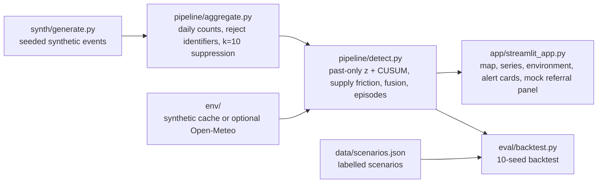

# MedS Hub Medicine Signals: technical document

**Challenge:** Future Health Digital Innovation Challenge, statement 06 (Population and Workforce Health Early Warning).
**Status:** working prototype on **synthetic data only**. It is not a validated or operational service.
**Author:** Mena Samy Tawfik Saad, pharmacist and founder of MedS Hub. I also reviewed the alert logic and wording as a pharmacist.

## 1. Problem and fit
In Egypt, people usually look for medicines at community pharmacies, often by brand name. When a medicine runs short, or demand for a class jumps (for example oral rehydration and antidiarrhoeals in a heatwave), the first signs show up at the counter. The same request is repeated from pharmacy to pharmacy, and people start asking for "anything like it". Pharmacists often see this weeks before an official report appears. The signal is real, but it is scattered and does not reach supply planners or public-health teams.

MedS Hub is a bilingual Arabic/English medicine catalog and pharmacy coordination app, with about 85,000 medicine records (October 2026). Medicine searches, pharmacy quote requests and "not available" replies are natural, countable signals of demand and supply friction.

This prototype shows how those signals could be:
1. aggregated safely
2. combined with environmental context
3. turned into explainable alerts that name a responsible role

That covers what statement 06 asks for: at least two materially different signal types, explainable anomaly detection, privacy-preserving views, and a backtest that reports sensitivity, PPV, false alarms, lead time and missing-input behaviour.

## 2. Architecture

The pipeline runs as stateless batch steps that read and write CSV and JSON. It is offline-first and has no telemetry. Its only network use is the dashboard map tiles and the optional Open-Meteo fetcher (see section 8).

## 3. Data (synthetic)
- **Size:** 90 days (1 Jul to 28 Sep 2026), 50 INNs in 6 therapeutic classes, and 6 governorates (Cairo, Giza, Alexandria, Qalyubia, Dakahlia, Assiut).
- **Event types (4):** `catalog_search`, `quote_request`, `quote_unavailable` and `alt_search_after_unavailable`.
- **Generator:** default seed `20261018`, weekday seasonality, a mild trend, and Poisson/binomial noise.
- **Labelled scenarios:**

| ID | Scenario | Design | Expected result |
|---|---|---|---|
| S1 | Supply shortage | Amlodipine in Alexandria and Dakahlia, 12–23 Aug | `possible_shortage` |
| S2 | Heatwave | Rising demand in the ORS/antidiarrhoeal class in all 6 governorates, 20–26 Aug, aligned with a synthetic temperature anomaly | `unusual_demand` |
| S3 | Media-driven search spike | Cetirizine: searches rise, availability stays normal | Negative control: no alert |
| S4 | Missing-data dates | Assiut and Qalyubia | Negative control: no confident alert |

- **Environment:** daily maximum temperature and PM2.5. The data is synthetic by default and labelled as such in the app. `env/fetch_open_meteo.py` can optionally fetch public data without an API key; it writes to a separate file so the demo cache is never overwritten.

## 4. Methods
- **Aggregation and privacy:** counts are grouped by date × INN × class × governorate × event type.
  - Input columns that look like identifiers (user, patient, prescription, phone, name, national ID and similar) are rejected.
  - Cells below **k=10** are suppressed and treated as missing, not zero.
  - Rows explicitly marked missing stay NaN, so they never lower a baseline.
- **Past-only baseline:** each series is first aligned to a full daily calendar.
  - The expected value for day *t* is the same-weekday median over the trailing 28 days (*t*−28 to *t*−1), after a 14-day warm-up.
  - Scale is the MAD of past residuals × 1.4826, with a floor of 2.0.
  - No future data is used. A test checks this.
- **Demand signal:** the `catalog_search` residual z-score is at least 2.8, **or** the one-sided CUSUM (slack 0.8) is at least 6.0.
- **Supply friction:** the ratio `quote_unavailable / quote_request`, capped at 1.0 (100%). The two counts are aggregated separately, so without the cap the raw ratio could exceed 1. The cap changes no alert decisions, because every threshold is below 1.
  - It counts when the ratio is at least 0.25, the local unavailable count is at least 10, and it **persists**: present today and on at least one of the previous 2 evaluated days.
  - If the local quote-request cell is suppressed, the denominator falls back to a coarser aggregate that clears k=10 (the national INN count, then class × governorate).
  - These roll-ups are internal and are never shown.
- **Environmental support:** applies only to pre-declared climate-sensitive classes. The baseline is the trailing 21-day median.
  - A temperature rise of at least +6 °C supports `antidiarrhoeals_ors`.
  - A PM2.5 rise of at least +25 µg/m³ supports `respiratory`.
- **Fusion rule:** an alert needs at least two signal types. The only single-signal route is extreme supply friction: a ratio of at least 0.55 with at least 10 unavailable.
  - **Demand alone never alerts**, whatever its size. This is why the media spike is ignored.
  - **Environment alone never alerts.**
- **Typing and episodes:** an alert is typed `possible_shortage` when supply friction is present on its start day; otherwise it is `unusual_demand`.
  - Daily alerts for the same INN × governorate are merged into episodes, allowing a gap of up to 2 days.
  - If supply friction appears later in an episode, the episode is upgraded. `initial_type` and `type_history` record the change.
- **Explainability:** every card lists each signal with its value and unit (for example `residual_z 3.1` and `unavailable_ratio 0.818`), the window, the assumptions, a responsible role and a suggested operational follow-up. A shortage goes to the pharmacy-network supply lead; unusual demand goes to the public-health surveillance officer. The follow-up is always to verify through authorised channels. Each card ends with "Signal for investigation, not a diagnosis."

## 5. Validation (synthetic backtest)
`eval/backtest.py` scores the alerts against the scenario labels on 10 original seeds and on a fresh, untouched hold-out of 10 seeds (100–109). Results are in `reports/backtest.md` and `reports/metrics.json`.

| Metric | Default seed 20261018 | Tuning, 5 seeds (mean) | Hold-out 2, 3, 5, 8, 13 (mean) | All 10 seeds: mean (min/max) | **Fresh hold-out 100–109: mean (min/max)** |
|---|---:|---:|---:|---:|---:|
| Alerts emitted | 32 | 32.2 | 35.2 | 33.7 (31–38) | 34.2 (33–35) |
| Scenario sensitivity (S1 + S2) | 100% | 100% | 100% | 100% (min 100%) | 100% (min 100%) |
| Series sensitivity | 100% | 99.4% | 100% | 99.7% (min 96.9%) | 99.4% (min 96.9%) |
| Shortage series recall | 2/2 | 2/2 on all seeds | 2/2 on all seeds | 2/2 on all seeds | 2/2 on all seeds |
| Heatwave series recall | 30/30 | 149/150 | 150/150 | 299/300 | 298/300 |
| Alert-level PPV proxy | 100% | 100% | 98.9% | 99.5% (min 97.2%) | 99.4% (min 97.0%) |
| False alarms (count; per 30 days) | 0; 0.00 | 0; 0.00 | 2; 0.13 | 2; 0.07 (max 0.33) | 2; 0.07 (max 0.33) |
| Media-spike alerts (S3) | 0 | 0 | 0 | 0 on every seed | 0 on every seed |
| Missing-data alerts (S4) | 0 | 0 | 0 | 0 on every seed | 0 on every seed |
| Detection delay from onset | 0 days | 0 days | 0 days | 0 days | 0 days |

**Caveats**
- These are synthetic results with known labels. They are not real-world performance estimates.
- **The lead time is a detection delay of 0 days.** Alerts fire on the scenario's first day. This is not a prediction ahead of onset.
- The original hold-out seeds informed the final detector fix, so they are not fully untouched. **The fresh hold-out (seeds 100–109) is the clean result:** it was evaluated once, after the detector was frozen, and nothing was tuned afterwards.
- **Original 10 seeds, 2 false alarms:**
  - seed 5: enalapril, Assiut (extreme supply friction)
  - seed 13: cetirizine, Alexandria (a PM2.5 coincidence outside the media window)
- **Fresh hold-out, 2 false alarms:**
  - seed 104: the oral rehydration salts heatwave episode in Assiut was upgraded to `possible_shortage` when supply friction appeared mid-episode. It counts as both a missed heatwave series and a false alarm.
  - seed 107: ambroxol, Giza (extreme supply friction)
- **Fresh hold-out, missed series:** seed 106, probiotic mix in Alexandria, was not detected.
- "PPV" and "false alarm" are proxies: they score alerts against scenario labels, not against confirmed events.
- **Runtime on the dev box:** demo about 8–10 s, the 10 tests about 7 s, the full backtest (10 original + 10 fresh seeds) about 130 s.

## 6. Privacy, responsible AI and data governance
- **Synthetic only.** There is no production data path, and no individual-level data or identifiers. The pharmacy referral panel lists only fictional **MOCK** pharmacies.
- **Aggregate only, k=10 suppression.** The tool has no individual-level views. Suppression is not a guarantee of anonymity. A pilot needs a disclosure-risk review, complementary suppression and query controls.
- **Egypt PDPL (Law 151/2020).** Processing real data, including any cross-border hosting, would need a licence from Egypt's **Personal Data Protection Center**. **That licence has not been obtained yet; licensing is planned.** No claim of compliance or approval is made. A pilot would use opt-in consent for anonymised statistics, separate from service consent. The pipeline would receive only counts, never prescription images, free text or user IDs.
- **Human in the loop.** Alerts are operational signals for authorised human review. They are not diagnoses or confirmed shortages.
- **No clinical or substitution advice.** Any switch to another medicine remains a decision for a pharmacist or prescriber.
- **Not yet implemented** (required before a pilot): role-based access control, audit logging, secrets management, retention rules and incident response.
- **Known biases:** app users are not representative (urban, smartphone-owning, literate). Price changes, promotions and media also move demand.

## 7. Assumptions
- Synthetic counts stand in for aggregate product-interest events, not actual sales.
- The ratio of quote-unavailable replies to quote requests is a proxy for supply friction, not a measure of stock.
- A single alert does not prove a shortage or a public-health event.

## 8. Dependencies
- **Python:** 3.11 or later (developed and tested with 3.13).
- **Packages** (`requirements.txt`): pandas >=2.1,<3 · numpy >=1.26,<3 · streamlit >=1.35,<2 · plotly >=5.20,<7 · pytest >=8,<9 · requests >=2.31,<3 (used only by the optional Open-Meteo fetcher).
- **Outside services:** the dashboard map (`st.map`) loads public basemap tiles from CARTO, built on OpenStreetMap data, in the viewer's browser. The demo, tests and backtest make no other network calls, and Streamlit usage statistics are switched off. The only other network code is the optional `env/fetch_open_meteo.py` (public Open-Meteo API, no key), which runs only when started by hand.
- **Data:** synthetic only, generated locally from fixed seeds (`synth/`, `env/make_synthetic_env.py`). There is no dependency on MedS Hub production systems, real users, prescriptions, pharmacies or transactions.

## 9. Limitations
- **Synthetic scope:** the thresholds are hand-set and must be calibrated on real, prospective data.
- **Warm-up:** the baseline needs 14 days of history before it scores a day.
- **Suppression boundary:** supply friction is observable only where the local unavailable count is at least 10. Small areas and rare medicines can be invisible.
- **Residual false alarms:** persistent noise or environmental coincidences can still cause them (2 across the original 10 seeds; 2 across the fresh 10).
- **Episode relabelling:** an unusual-demand episode can be upgraded to `possible_shortage` if supply friction appears mid-episode. In a heatwave this can be the wrong label (fresh seed 104).
- **Extreme supply-only cards:** an alert raised by the extreme supply-friction route before the friction has persisted can show an empty signal list on its card. The card's explanation needs to name that route.
- **Coverage:** Egypt only, and governorate level only. There is no link yet to clinical, laboratory or regulator shortage data. Grouping catalog records by INN needs cleaning where scientific names are missing.
- **Performance:** detection still loops row by row. That is fine at this scale but not yet optimised for national volume.

## 10. Scalability and deployment
For a pilot:
- scheduled aggregate ingestion
- partitioned time-series storage (Postgres)
- data-quality and missing-input monitoring
- versioned thresholds and reproducible runs
- alert deduplication and acknowledgement
- access logging and RBAC
- monitored deployment

The design keeps only the minimum aggregate granularity. It carries over to any Arabic-speaking pharmacy network where a local partner supplies the data under local law.

## 11. Pilot plan and commercial path
1. **Now (Nov 2026):** this synthetic prototype, published and reproducible.
2. **Governance first:** legal review, the PDPC licensing process, a data-sharing agreement and opt-in consent for anonymised statistics in the MedS Hub app.
3. **Shadow mode (3 months) with participating pilot pharmacies.** Alerts are logged but not acted on, and are compared with pharmacists' own shortage reports. Then thresholds are re-calibrated and real sensitivity, PPV and lead time are measured.
4. **Aggregated weekly digest:** first for the pilot pharmacies, then for interested pharmacy-network or public-health stakeholders. No partnerships are claimed.

**Commercial hypotheses (not validated):**
- B2B dashboards for pharmacy chains and distributors, for stock planning
- aggregated insight reports
- public-sector surveillance contracts

No customers, prices or revenue are claimed.

## 12. How to run
```bash
python -m venv .venv && . .venv/bin/activate && pip install -r requirements.txt
make demo        # or ./run.sh demo
make test        # or ./run.sh test (pytest -q)
make backtest    # or ./run.sh backtest
streamlit run app/streamlit_app.py
```
